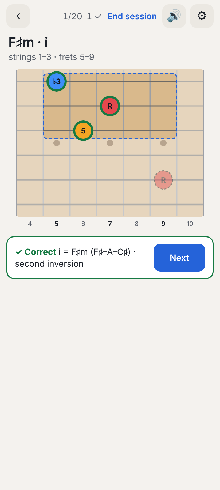
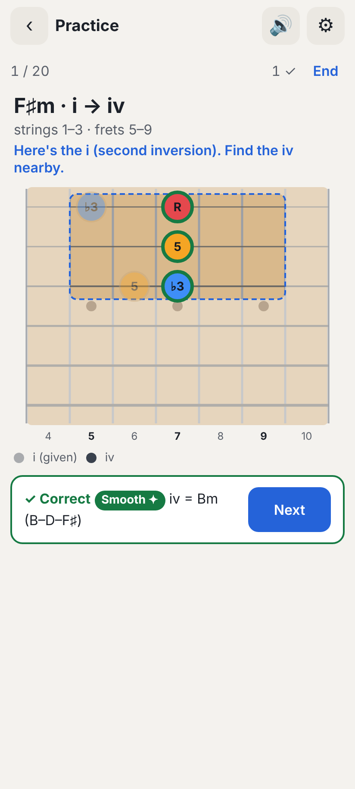
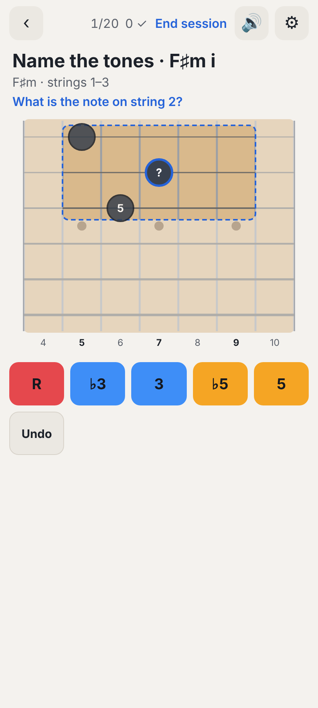
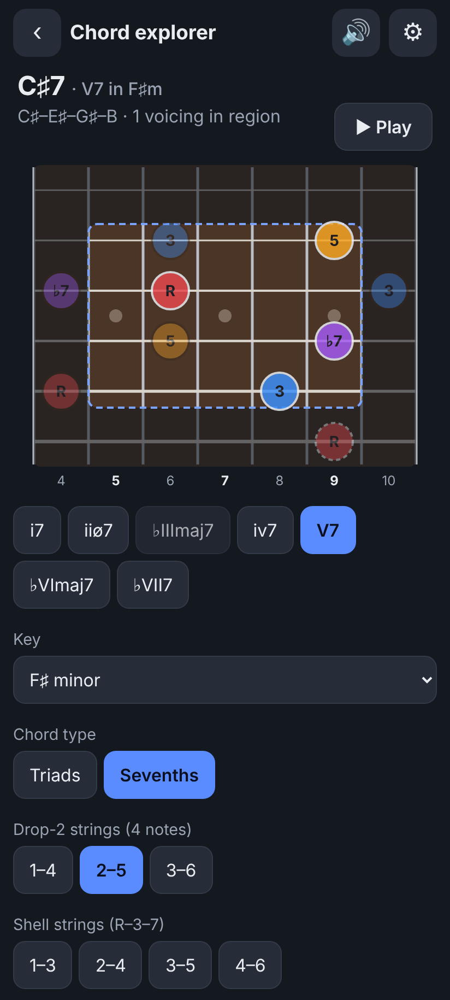
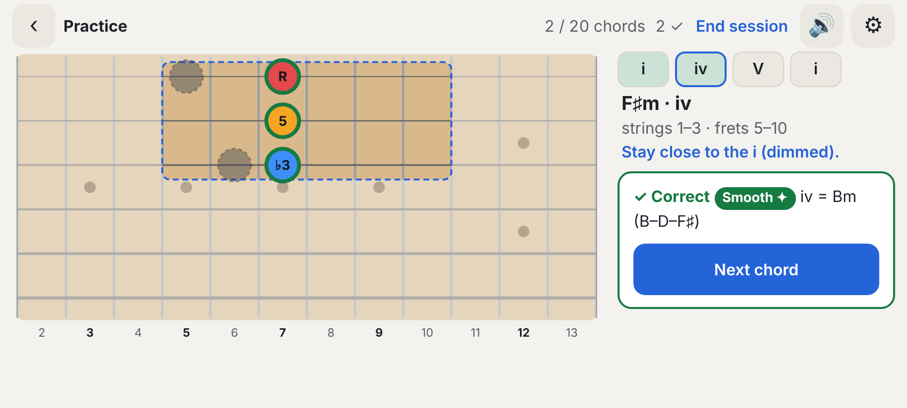
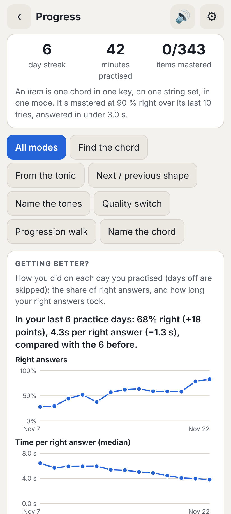
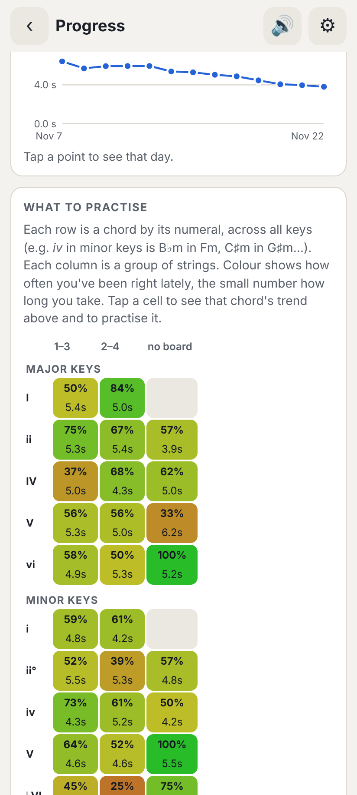
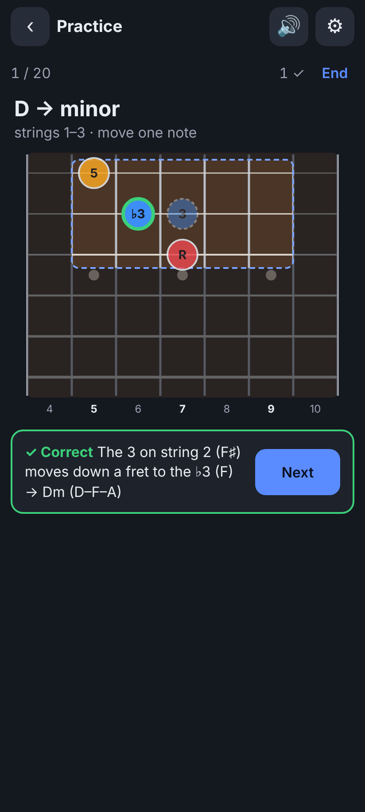
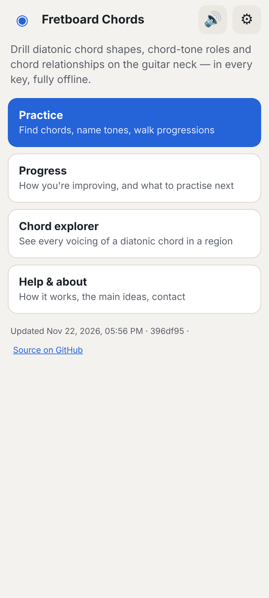
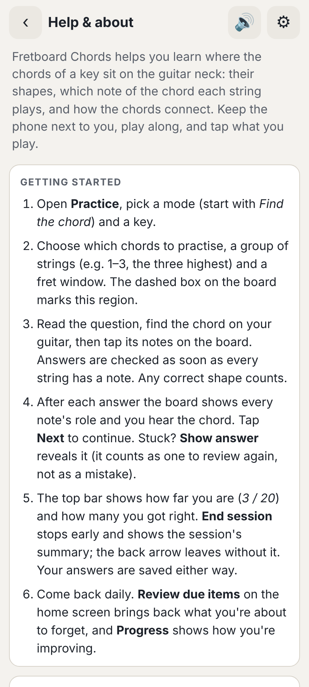

# Fretboard Chords

Learn where every diatonic chord lives on the guitar neck: its shapes, which note of the
chord each string is playing, and how chords in a key connect. Fretboard Chords is a
free, offline-first web app you can install on your phone and use with the guitar in your
lap.

**▶ Open the app: https://shushz.github.io/fretboard-chords/**

It works in any modern browser and can be installed to the home screen (Android: Chrome
menu → _Install app_; iOS: Share → _Add to Home Screen_). After the first visit it runs
fully offline.

<p>
  
  
  
  
</p>

## What you practise

Pick a key, the chords you care about (the core set by default, e.g. i, iv, V, ii°, ♭VI,
♭VII in minor), a group of strings and a fret window. Then choose a mode:

| Mode                      | What you do                                                                                                                                                                                                    |
| ------------------------- | -------------------------------------------------------------------------------------------------------------------------------------------------------------------------------------------------------------- |
| **Find the chord**        | “F♯m · iv · strings 2–4 · frets 6–10”: tap the chord. Any valid shape counts; a miss shows every right shape with its roles. Optional _anchored_ variant: tap the root on string 6 or 5 first, then the chord. |
| **From the tonic**        | You're shown the I/i chord; find the IV, V, vi… nearby. A **Smooth ✦** badge marks the shape with the least movement.                                                                                          |
| **Next / previous shape** | You're shown one shape; find the next one up (or down) the neck on the same strings.                                                                                                                           |
| **Name the tones**        | Label each note of a shown shape as R, ♭3, 3, 5, ♭7…, or the reverse: “tap the ♭3 of V on string 2”.                                                                                                           |
| **Quality switch**        | Turn a major chord minor (or back) by moving the one note that has to move. Extensions: minor ↔ diminished, major → augmented, V → V7, maj7 ↔ 7, m7 ↔ m7♭5.                                                    |
| **Progression walk**      | Walk real progressions (I–vi–ii–V, i–♭VI–♭VII–i, ii°–V–i, …) chord by chord, staying close to the last shape. Optional tempo mode.                                                                             |
| **Name the chord**        | “In E♭m, what is iv?” → A♭m (not G♯m); “what chord is on the 4th degree?”, where the quality counts too (A♭m or A♭?); and the reverse.                                                                         |

Every mode works with **triads or seventh chords** (drop-2 voicings on four strings, or
R–3–7 shells), in **one key or a random key** per question.

### Progress and review

- **Getting better?** The Progress screen charts each day you practised: how often you were
  right and how long right answers took, with a plain summary (“In your last 5 practice
  days: 72% right (+23 points), 4.3 s per right answer (−1.0 s)…”). Filter by mode.
- **What to practise:** a map of chords by numeral (across all keys) × string set, coloured
  by recent accuracy. Tap a cell to see that chord's trend and practise it.
- **Spaced repetition** steers questions toward what's due and what's weak. _Review due
  items_ and _Drill these_ (your 10 weakest items) run targeted sessions.
- Export and import your progress as JSON. Everything stays on your device.

<p>
  
  
  
</p>

### Music details it gets right

- **Correct spelling in every key.** Notes are spelled from the key's letters, never
  from pitch alone. In G♯ minor the V chord is D♯–F𝄪–A♯, and in E♭ minor the ii° is
  F–A♭–C♭. Theoretical keys such as G♭m can be enabled and are spelled with double flats.
- **Your choice of enharmonic keys** (D♭ or C♯, E♭m or D♯m, …), harmonic V/V7 or natural
  v in minor, and which string sets to practise. These are all preferences, not hard-coded.
- **Plucked-string sound**, synthesised in the browser: you hear each note you tap, a
  strum when you're right, a muted thunk when you're not.
- **Hints you control.** Role labels and colours on a given shape can be hidden, since
  they give the answer away.
- **Help built in.** _Help & about_ explains getting started, the main ideas (roles,
  numerals, string sets, inversions, anchors…) and every mode; each mode's setup has a
  short _How it works_.

<p>
  
  
  
</p>

## Development

Built with TypeScript, [Vite](https://vitejs.dev/) and [Preact](https://preactjs.com/),
with an SVG fretboard and the Web Audio API. There's no backend: it's a static PWA
(service worker via `vite-plugin-pwa`) with progress stored in IndexedDB.

```bash
npm install
npm run dev        # dev server at http://localhost:5173/fretboard-chords/
```

| Command            | What it does                                                                                                      |
| ------------------ | ----------------------------------------------------------------------------------------------------------------- |
| `npm test`         | Unit tests (Vitest), including property tests that check every mode against generated setups in all 24 keys       |
| `npm run test:e2e` | End-to-end tests (Playwright) at phone size                                                                       |
| `npm run audit`    | Automated walkthrough of every screen at 4 sizes, light and dark: errors, overflow, tap targets ≥ 44 px, contrast |
| `npm run lint`     | ESLint and Prettier                                                                                               |
| `npm run build`    | Production build into `dist/`                                                                                     |

Playwright needs a Chromium build: `npx playwright install chromium`.

CI runs lint, tests, build, e2e and the audit on every pull request. Every pull request
also gets a **live preview** (with its own storage and demo data) at
`https://shushz.github.io/fretboard-chords/pr-preview/pr-<number>/`, linked in a PR comment.
Every push to `main` deploys the live app to GitHub Pages.

### Project layout

```
src/
  theory/      notes, spelling, keys, chords, roles (pure TypeScript)
  fretboard/   tuning, voicing enumeration, anchors, movement (pure TypeScript)
  exercises/   one folder per mode: question generation + grading (pure) and its UI
  progress/    item stats, spaced repetition, IndexedDB, backup
  audio/       plucked-string synth and feedback sounds
  prefs/       preferences model and storage
  ui/          fretboard component, screens, theme
tests/e2e/     Playwright specs (incl. the audit walkthrough)
docs/          changelog, decisions log, progress, screenshots
```

### Documentation

- [`SPEC.md`](SPEC.md): product spec and music-theory rules (the source of truth)
- [`docs/DECISIONS.md`](docs/DECISIONS.md): design decisions and why they were made
- [`docs/CHANGELOG.md`](docs/CHANGELOG.md): one line per change
- [`docs/PROGRESS.md`](docs/PROGRESS.md): milestone status
- [`CLAUDE.md`](CLAUDE.md): working rules for contributors, including AI agents

## Contributing

Issues and pull requests are welcome. Before opening a PR, run
`npm run lint && npm test && npm run build`, plus `npm run test:e2e` for UI changes. Any
change to music theory or fretboard logic needs unit tests.

## License

[MIT](LICENSE)
